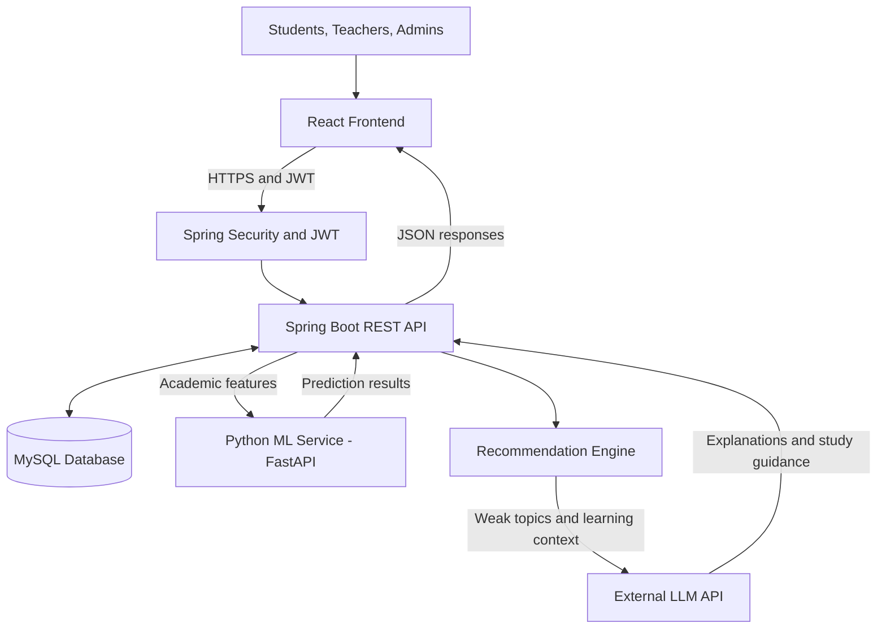

# EDUAI — AI-Powered Personalized Learning Platform

<p align="center">
  <strong>Learn Smarter. Understand Better. Achieve More.</strong>
</p>

<p align="center">
  A personalized digital learning platform that combines academic management, machine learning, and AI-powered learning assistance to help students improve their academic performance.
</p>

---

## 📌 Table of Contents

- [1. Project Overview](#-1-project-overview)
- [2. Problem Statement](#-2-problem-statement)
- [3. Project Objectives](#-3-project-objectives)
- [4. Key Features](#-4-key-features)
- [5. System Architecture](#-5-system-architecture)
- [6. Technology Stack](#-6-technology-stack)
- [7. User Roles and Permissions](#-7-user-roles-and-permissions)
- [8. AI and Machine Learning](#-8-ai-and-machine-learning)
- [9. Database Design](#-9-database-design)
- [10. Project Structure](#-10-project-structure)
- [11. Team Responsibilities](#-11-team-responsibilities)
- [12. Development Roadmap](#-12-development-roadmap)
- [13. Getting Started](#-13-getting-started)
- [14. Environment Configuration](#-14-environment-configuration)
- [15. API Design](#-15-api-design)
- [16. Security](#-16-security)
- [17. Testing Strategy](#-17-testing-strategy)
- [18. Deployment](#-18-deployment)
- [19. Expected Outcomes](#-19-expected-outcomes)
- [20. Academic Integrity and Limitations](#-20-academic-integrity-and-limitations)
- [21. Future Enhancements](#-21-future-enhancements)
- [22. Team](#-22-team)
- [23. License](#-23-license)

---

## 🎓 1. Project Overview

**EDUAI** is an AI-powered personalized learning platform designed to help students understand their academic performance, identify knowledge gaps, and receive personalized learning recommendations.

Traditional learning management systems primarily focus on delivering educational content, managing assessments, and recording grades. EDUAI extends this approach by combining academic management with machine learning predictions and AI-generated learning guidance.

The platform analyzes relevant academic indicators, including quiz results, assignment marks, attendance, previous performance, and learning activity. Based on these indicators, the system can estimate academic performance, identify potential weak areas, and recommend suitable learning activities.

An AI Tutor provides explanations and study guidance adapted to the student's learning level.

### Project Information

| Item | Details |
|---|---|
| Project Name | EDUAI |
| Project Type | Full-Stack Software Engineering Project |
| Domain | Education Technology (EdTech) |
| Primary Goal | Personalized and data-driven learning |
| Frontend | React |
| Backend | Java Spring Boot |
| Database | MySQL |
| Authentication | Spring Security and JWT |
| Machine Learning | Python and scikit-learn |
| ML API | FastAPI |
| Team Size | 2 members |
| Development Approach | Iterative development |

## 🎯 2. Problem Statement

Students often face difficulties identifying their academic weaknesses and deciding what they should study next. Teachers may also need to spend considerable time reviewing student performance and identifying learners who require additional support.

Common problems include:

- Students receive marks without clear, actionable improvement guidance.
- Learning recommendations are not always personalized.
- Weak topics can remain unnoticed until major examinations.
- Teachers must manually review academic performance across multiple assessments.
- Students may struggle to find appropriate explanations for difficult concepts.
- Academic information may be distributed across different tools and systems.

EDUAI addresses these problems through a centralized academic platform supported by machine learning, rule-based analysis, and an AI Tutor.

## 🚀 3. Project Objectives

The main objectives are to:

1. Develop a secure academic management platform for students, teachers, and administrators.
2. Provide personalized student dashboards and academic progress tracking.
3. Manage courses, lessons, assignments, quizzes, attendance, and grades.
4. Apply machine learning to estimate student academic performance.
5. Identify weak subjects and topics using academic results and configurable rules.
6. Recommend suitable learning activities based on identified weaknesses.
7. Provide an AI Tutor that explains concepts and generates study guidance.
8. Help teachers identify students who may benefit from additional academic support.
9. Maintain reliable academic records using a relational database.
10. Demonstrate software engineering practices, including API design, testing, version control, and deployment.

## ✨ 4. Key Features

### 4.1 Authentication and User Management

- Student registration and login.
- Teacher and administrator accounts.
- JWT-based authentication.
- Role-based access control.
- Password hashing using BCrypt.
- Protected frontend routes.
- Profile management.
- Logout and token invalidation handling.
- Password recovery and reset workflows.

### 4.2 Student Dashboard

The student dashboard provides a personalized overview of academic progress.

Features include:

- Enrolled courses.
- Upcoming assignments and quizzes.
- Recent marks and assessment results.
- Attendance percentage.
- Performance charts.
- Identified weak subjects and topics.
- Predicted academic performance, where sufficient data is available.
- Recommended learning activities.
- Today's Recommended Learning section.

### 4.3 Course and Lesson Management

- Create and manage courses.
- Organize course content into modules and lessons.
- Upload or link learning materials.
- Browse available courses.
- Enroll students in courses.
- Track learning progress.
- View lesson completion status.

### 4.4 Assignments and Assessments

- Teachers create assignments with deadlines.
- Students submit their work.
- Teachers review submissions and award marks.
- Store submission status and feedback.
- Display assignment results.
- Track assessment history.

### 4.5 Interactive Quiz System

- Create quizzes with questions and answer options.
- Support multiple-choice questions initially.
- Automatically mark objective questions.
- Calculate quiz scores and percentages.
- Store quiz attempts and results.
- Display explanations and feedback.
- Track performance by subject and topic.

### 4.6 Attendance and Grade Management

- Record student attendance.
- Calculate attendance percentages.
- Maintain assessment marks and grades.
- View academic performance by course.
- Display performance trends.
- Provide authorized teachers with class-level summaries.

### 4.7 Machine Learning Performance Prediction

The ML service analyzes academic indicators to estimate future performance or classify students into configurable risk categories.

Potential outputs include:

- Predicted final examination score.
- High, Medium, or Low performance-risk classification.
- Prediction confidence or uncertainty, when supported by the model.

### 4.8 Weak-Topic Detection

The platform identifies subjects or topics that may need additional attention.

Example:

If a student's Java OOP quiz average is below the configured threshold, the platform can flag Java OOP as a weak topic.

The system then recommends relevant lessons, practice quizzes, and estimated study time.

### 4.9 AI Tutor

The AI Tutor helps students understand difficult concepts.

Planned capabilities:

- Ask questions about course topics.
- Receive beginner-friendly explanations.
- Request examples and step-by-step guidance.
- Generate practice questions.
- Receive personalized study suggestions.
- View previous conversations.

AI responses should support learning rather than replace the student's own work.

### 4.10 Teacher Analytics

- View class performance summaries.
- Identify students who may need additional support.
- Review attendance and assessment trends.
- Inspect model predictions alongside actual academic results.
- Review course-level weak-topic patterns.

### 4.11 Optional Enhancements

These features will be considered after the core system is stable:

- AI-generated study planners.
- Deadline reminders and notifications.
- Downloadable academic reports.
- Gamification with points, badges, and study streaks.
- Additional question types.
- Advanced teacher analytics.

---

## 🏗️ 5. System Architecture

EDUAI uses a modular architecture with a React frontend, Spring Boot backend, MySQL database, Python ML service, and an external LLM API.



### 5.1 Component Responsibilities

| Component | Responsibility |
|---|---|
| React Frontend | User interface, dashboards, quizzes, charts, and AI Tutor |
| Spring Boot Backend | Business logic, REST APIs, validation, and authorization |
| Spring Security | Authentication and access control |
| MySQL | Users, courses, assessments, marks, attendance, and predictions |
| Python ML Service | Model loading, feature processing, and performance prediction |
| Recommendation Engine | Weak-topic detection and learning activity selection |
| LLM API | Natural-language explanations and personalized study guidance |

### 5.2 System Conditions and Business Rules

**Access control**

- Unauthenticated requests to protected endpoints return `401 Unauthorized`.
- Authenticated users without the required permissions receive `403 Forbidden`.
- Students must not access another student's private academic records.
- Teachers can access only the classes and courses they are authorized to manage.

**Data supplied to the ML model**

Potential features include:

- Quiz average.
- Assignment average.
- Attendance percentage.
- Study hours, if reliably collected.
- Previous assessment marks.
- Learning activity indicators.

The model must receive the same feature definitions, units, and preprocessing used during training.

**Prediction output**

The model returns a predicted score or a supported risk classification. Predictions should be stored with the model version, timestamp, and relevant evaluation metadata where appropriate.

**Weak-topic detection**

Example rule:

- If a topic score is below 50%, flag that topic for additional review.
- If the configured model identifies a student as at risk, recommend reviewing the relevant academic indicators.
- A risk prediction alone should not automatically label every subject as weak.

**Recommendation generation**

The recommendation engine selects relevant lessons, practice activities, and suggested study time based on the student's actual learning needs and available course content.

**AI Tutor**

The LLM receives relevant topic information, the student's selected learning level, and appropriate course context. It generates an explanation or study plan that the student can review and act upon.

**Feedback loop**

New quiz attempts, assignment results, and learning activity update the student's academic record. Future predictions can use updated data when the model and prediction schedule support it.

### 5.3 ML vs. LLM

| Machine Learning | Large Language Model |
|---|---|
| Estimates likely academic outcomes from structured data | Explains concepts using natural language |
| Produces a score or risk classification | Produces explanations, examples, and study guidance |
| Evaluated using model metrics | Evaluated using relevance, correctness, and safety checks |
| Uses a trained predictive model | Uses an external or locally hosted language model |

**Important:** The ML model answers, "What academic outcome might be likely?" The LLM answers, "How can the student understand the topic and improve?" These are separate responsibilities.

---

## 🛠️ 6. Technology Stack

| Technology | Purpose |
|---|---|
| React | Frontend development |
| Java | Backend programming |
| Spring Boot | REST API and business logic |
| Spring Security | Authentication and authorization |
| JWT | API access tokens |
| Spring Data JPA | Database persistence |
| Hibernate | Object-relational mapping |
| MySQL | Relational database |
| Maven | Java dependency and build management |
| Python | ML development |
| pandas | Dataset processing |
| NumPy | Numerical computation |
| scikit-learn | Model training and evaluation |
| joblib | Model serialization |
| FastAPI | Python ML API |
| REST and JSON | Communication between services |
| Git and GitHub | Version control and collaboration |
| JUnit | Backend testing |
| pytest | ML service testing |
| Docker | Containerization, planned |
| GitHub Actions | CI/CD, optional |

An external LLM API can be integrated for AI Tutor responses. The provider and model will be selected during implementation.

---

## 👥 7. User Roles and Permissions

### Student

- Manage their own profile.
- Browse courses and enroll where permitted.
- Access enrolled course materials.
- Complete quizzes and assignments.
- View their own marks, attendance, and academic history.
- Receive personalized recommendations.
- Use the AI Tutor.
- View performance predictions and learning analytics.

### Teacher

- Manage authorized courses, modules, and lessons.
- Create assignments and quizzes.
- Review submissions and award marks.
- Record attendance.
- View authorized student performance.
- Review class analytics and model predictions.

### Administrator

- Manage user accounts and roles.
- Manage platform-wide settings.
- Oversee courses and platform operations.
- Monitor system-level activity and access.

Every role must be enforced by the backend, not only by hiding frontend pages.

---

## 🤖 8. AI and Machine Learning

### 8.1 ML Problem Definition

The project can implement one primary prediction task initially.

**Option A — Regression**

Predict a student's final examination score.

Possible models:

- Linear Regression.
- Random Forest Regressor.

Evaluation metrics:

- Mean Absolute Error (MAE).
- Root Mean Squared Error (RMSE).
- R-squared (\(R^2\)).

**Option B — Classification**

Classify a student's academic performance or support needs into defined categories.

Possible models:

- Logistic Regression.
- Random Forest Classifier.

Evaluation metrics:

- Accuracy.
- Precision.
- Recall.
- F1-score.
- Confusion matrix.

The classification labels and thresholds must be defined consistently. If the classes are imbalanced, accuracy alone is not sufficient.

### 8.2 ML Development Pipeline

1. Obtain a suitable public dataset or generate clearly documented synthetic data.
2. Inspect missing values, data quality, and feature distributions.
3. Define the prediction target and input features.
4. Split data into training and test sets.
5. Fit preprocessing and models using the training data.
6. Compare suitable baseline and alternative models.
7. Evaluate the final model on held-out test data.
8. Save the model and preprocessing pipeline.
9. Load the trained artifact in FastAPI.
10. Expose a validated `/predict` endpoint.
11. Integrate the endpoint with Spring Boot.
12. Store predictions and show the results in authorized dashboards.

### 8.3 Example Prediction Request

```json
{
  "attendance_percentage": 85,
  "quiz_average": 72,
  "assignment_average": 68,
  "study_hours_per_week": 8,
  "previous_marks": 65
}
```

This is an illustrative request schema. The final feature names and values must match the trained model.

### 8.4 Example Prediction Response

```json
{
  "predicted_score": 74.5,
  "model_version": "1.0"
}
```

The output is illustrative, not a real model result. A risk classification can be used instead if classification is selected.

### 8.5 Recommendation Workflow

1. Retrieve the student's academic records.
2. Calculate topic-level and subject-level performance.
3. Identify weak areas using documented rules.
4. Retrieve suitable lessons and quizzes from the course library.
5. Create a prioritized recommendation list.
6. Use the LLM to explain why the selected activity may help.
7. Display the recommendation on the student dashboard.
8. Record subsequent assessment results to support future analysis.

### 8.6 AI and ML Limitations

- Synthetic training data does not prove real-world predictive accuracy.
- Predictions are estimates, not guarantees.
- Historical academic data can contain bias or incomplete information.
- Study hours should not be treated as reliable unless the collection method is documented.
- LLM-generated explanations may contain errors and should be checked.
- Students and teachers should be able to distinguish measured marks from predicted results.

---

## 🗄️ 9. Database Design

The following tables represent the proposed logical database design. Final columns, keys, constraints, and relationships will be documented in the ER diagram and implemented through the backend entities and migrations.

### 9.1 Authentication and Users

| Table | Purpose |
|---|---|
| `users` | Login credentials and account information |
| `roles` | Available system roles |
| `user_roles` | User-to-role relationships, if multiple roles are supported |
| `students` | Student-specific profile information |
| `teachers` | Teacher-specific profile information |
| `password_reset_tokens` | Secure password-reset token records |

### 9.2 Academic Management

| Table | Purpose |
|---|---|
| `courses` | Course details |
| `modules` | Course modules |
| `lessons` | Learning content |
| `course_enrollments` | Student enrollment records |
| `learning_materials` | Documents and other learning resources |

### 9.3 Assignments and Quizzes

| Table | Purpose |
|---|---|
| `assignments` | Assignment details and deadlines |
| `submissions` | Student submissions and marks |
| `quizzes` | Quiz configuration |
| `questions` | Quiz questions |
| `question_options` | Options for objective questions |
| `quiz_attempts` | Individual quiz attempts |
| `quiz_answers` | Answers submitted by students |

### 9.4 Academic Records

| Table | Purpose |
|---|---|
| `attendance` | Attendance records |
| `grades` | Assessment and grade records |
| `learning_activity` | Selected learning events and progress |

### 9.5 AI and ML

| Table | Purpose |
|---|---|
| `ml_predictions` | Model predictions and associated metadata |
| `weak_topics` | Identified weak subjects or topics |
| `learning_recommendations` | Recommended learning activities |
| `ai_conversations` | AI Tutor conversation records |
| `ai_messages` | Individual conversation messages |

### 9.6 Important Database Rules

- Use primary keys and foreign keys to maintain relationships.
- Apply unique constraints to usernames or email addresses as appropriate.
- Store passwords as BCrypt hashes, never as plaintext.
- Prevent duplicate enrollment and invalid duplicate attendance records.
- Validate marks against the maximum permitted score.
- Record timestamps for submissions, attempts, and predictions.
- Restrict access to personal academic records.
- Define a retention policy for sensitive student information.

---

## 📂 10. Project Structure

Recommended repository layout:

```text
EDUAI/
│
├── frontend/
│   ├── public/
│   ├── src/
│   │   ├── assets/
│   │   ├── components/
│   │   ├── layouts/
│   │   ├── pages/
│   │   │   ├── auth/
│   │   │   ├── student/
│   │   │   ├── teacher/
│   │   │   ├── admin/
│   │   │   └── tutor/
│   │   ├── services/
│   │   ├── context/
│   │   ├── hooks/
│   │   └── App.jsx
│   └── package.json
│
├── backend/
│   ├── src/
│   │   ├── main/
│   │   │   ├── java/
│   │   │   │   └── com/eduai/
│   │   │   │       ├── config/
│   │   │   │       ├── security/
│   │   │   │       ├── controller/
│   │   │   │       ├── service/
│   │   │   │       ├── repository/
│   │   │   │       ├── entity/
│   │   │   │       ├── dto/
│   │   │   │       └── exception/
│   │   │   └── resources/
│   │   └── test/
│   └── pom.xml
│
├── ml-service/
│   ├── app/
│   │   ├── main.py
│   │   ├── schemas.py
│   │   └── predictor.py
│   ├── models/
│   ├── notebooks/
│   ├── tests/
│   └── requirements.txt
│
├── database/
│   ├── schema.sql
│   └── seed.sql
│
├── docs/
│   ├── architecture.md
│   ├── database-design.md
│   ├── api-documentation.md
│   ├── ml-evaluation.md
│   ├── testing.md
│   └── screenshots/
│
├── .gitignore
├── .env.example
├── docker-compose.yml
└── README.md
```

This structure is a target layout. Directories and files should be added as the corresponding features are implemented.

---

## 🤝 11. Team Responsibilities

EDUAI is developed by a two-member team. Responsibilities are divided by primary ownership, with collaboration on shared components.

### Vinuda Edirisooriya

**Primary focus: Student Experience and AI/ML**

- Student dashboard and profile UI.
- Course browsing and lesson-viewing interfaces.
- Quiz-taking and results interfaces.
- Student performance charts.
- ML dataset preparation and feature engineering.
- Model training and evaluation.
- FastAPI prediction service.
- Weak-topic detection and recommendation logic.
- AI Tutor frontend and learning experience.
- Integration testing for student-facing features.

### Thenuk

**Primary focus: Academic Management and Backend**

- Course, module, and lesson management APIs.
- Enrollment management.
- Assignment creation, submissions, and marking.
- Quiz and question management.
- Attendance and grade management.
- Teacher and administrator interfaces.
- Spring Boot integration with the ML service.
- Prediction persistence and teacher analytics APIs.
- Backend business logic and validation.
- Academic data integrity and testing.

### Shared Responsibilities

Both team members contribute to:

- Requirements analysis.
- Authentication and role-based authorization.
- Database and ER diagram design.
- API contract design.
- Code reviews and GitHub pull requests.
- Integration testing.
- Security and privacy.
- Deployment and project documentation.
- Final demonstration and individual contribution evidence.

**Collaboration rule:** Agree on endpoint names, request/response formats, database ownership, and integration contracts before implementing dependent features.

---

## 🗓️ 12. Development Roadmap

The following is a proposed 14-week schedule. Adjust it to match university deadlines and the team's available time.

| Phase | Timeline | Deliverables |
|---|---|---|
| 1. Planning and setup | Week 1 | Requirements, GitHub, architecture, ER diagram |
| 2. Authentication | Weeks 1–2 | Registration, login, JWT, role permissions |
| 3. Academic core | Weeks 3–5 | Courses, lessons, enrollment, student dashboard |
| 4. Assessments | Weeks 5–8 | Assignments, quizzes, marks, attendance |
| 5. ML service | Weeks 8–10 | Dataset, trained model, evaluation, prediction API |
| 6. AI and recommendations | Weeks 10–12 | Weak-topic detection, AI Tutor, study recommendations |
| 7. Optional features | Weeks 12–13 | Planner, notifications, reports, gamification |
| 8. Testing and delivery | Weeks 13–14 | Integration tests, deployment, documentation, demo |

### Milestones

- [ ] M1: Repository and project structure created.
- [ ] M2: Authentication and role-based access working.
- [ ] M3: Core course and enrollment workflows working.
- [ ] M4: Assessments and academic records working.
- [ ] M5: Student dashboard displaying real stored data.
- [ ] M6: ML model trained and evaluated.
- [ ] M7: Spring Boot successfully communicating with the ML service.
- [ ] M8: Personalized recommendations and AI Tutor integrated.
- [ ] M9: Main user journeys tested.
- [ ] M10: Documentation and final demonstration completed.

---

## 💻 13. Getting Started

### Prerequisites

Install the following development tools:

- Git.
- Node.js and npm.
- A compatible JDK.
- Apache Maven.
- MySQL Server.
- Python.
- An IDE such as IntelliJ IDEA or Visual Studio Code.

Use versions compatible with the selected Spring Boot release. Verify the installed tools before starting.

```bash
git --version
node --version
npm --version
java --version
mvn --version
python --version
```

### Step 1: Clone the Repository

Replace the placeholder URL with the actual EDUAI repository URL.

```bash
git clone <YOUR_EDUAI_GITHUB_REPOSITORY_URL>
cd EDUAI
```

### Step 2: Configure MySQL

Create the development database:

```sql
CREATE DATABASE eduai_db
CHARACTER SET utf8mb4
COLLATE utf8mb4_unicode_ci;
```

Create a dedicated database user with only the permissions required by the application. Configure credentials using environment variables.

The actual tables should be created through the chosen database migration strategy or the configured JPA development setup.

### Step 3: Start the Spring Boot Backend

```bash
cd backend
mvn spring-boot:run
```

The default local address is commonly:

```text
http://localhost:8080
```

This assumes the application is configured to use port `8080`.

### Step 4: Start the React Frontend

Open another terminal:

```bash
cd frontend
npm install
npm run dev
```

Open the local URL printed by the frontend development server.

The frontend must be configured with the correct backend API URL and CORS settings.

### Step 5: Start the ML Service

Open another terminal:

```bash
cd ml-service
python -m venv .venv
```

Activate the virtual environment.

Windows PowerShell:

```powershell
.\.venv\Scripts\Activate.ps1
```

macOS or Linux:

```bash
source .venv/bin/activate
```

Install dependencies:

```bash
pip install -r requirements.txt
```

Start FastAPI after implementing the application entry point:

```bash
uvicorn app.main:app --reload --port 8000
```

The example assumes `app/main.py` exposes a FastAPI object named `app`.

### Step 6: Verify Integration

Confirm that:

- The frontend can communicate with the backend.
- The backend can access MySQL.
- JWT authentication works.
- Protected routes enforce permissions.
- The backend can reach the ML service.
- Prediction results are validated and stored.
- The AI Tutor can call the configured LLM provider securely.

---

## 🔐 14. Environment Configuration

Create a local `.env` file or configure environment variables through your development environment. Never commit real credentials.

Example `.env.example`:

```dotenv
# Database
DB_HOST=localhost
DB_PORT=3306
DB_NAME=eduai_db
DB_USERNAME=eduai_user
DB_PASSWORD=replace_with_local_password

# Backend
SERVER_PORT=8080
FRONTEND_URL=http://localhost:5173
ML_SERVICE_URL=http://localhost:8000

# JWT
JWT_SECRET=replace_with_a_long_random_secret
JWT_EXPIRATION_MS=3600000

# LLM
LLM_API_KEY=replace_with_your_api_key
LLM_MODEL=replace_with_supported_model_name
```

These variables are examples, not automatically configured application properties. Map them to the relevant Spring Boot and Python configuration.

Security requirements:

- Never commit `.env`.
- Never expose API keys in React code.
- Use a strong, randomly generated JWT signing secret.
- Keep production secrets in the deployment platform's secret manager.
- Use HTTPS in production.
- Configure JWT expiration and refresh behavior deliberately.

---

## 🔌 15. API Design

The backend exposes REST APIs using JSON. The routes below are a proposed contract and must be implemented before they can be used.

| Method | Endpoint | Purpose |
|---|---|---|
| POST | `/api/auth/register` | Register an account |
| POST | `/api/auth/login` | Authenticate a user |
| POST | `/api/auth/forgot-password` | Start password recovery |
| POST | `/api/auth/reset-password` | Reset a password securely |
| GET | `/api/student/dashboard` | Retrieve student dashboard data |
| GET | `/api/courses` | Browse authorized courses |
| GET | `/api/student/enrollments` | View the student's enrollments |
| GET | `/api/courses/{courseId}/lessons` | Retrieve course lessons |
| GET | `/api/student/assignments` | View student assignments |
| POST | `/api/student/assignments/{assignmentId}/submissions` | Submit assignment work |
| GET | `/api/student/quizzes` | Retrieve available quizzes |
| POST | `/api/student/quizzes/{quizId}/attempts` | Submit a quiz attempt |
| GET | `/api/student/attendance` | Retrieve attendance records |
| GET | `/api/student/grades` | Retrieve academic results |
| GET | `/api/student/predictions/latest` | Retrieve the latest prediction |
| GET | `/api/student/recommendations` | Retrieve learning recommendations |
| POST | `/api/student/ai-tutor/messages` | Send a message to the AI Tutor |
| POST | `/api/teacher/courses` | Create a course |
| POST | `/api/teacher/assignments` | Create an assignment |
| POST | `/api/teacher/quizzes` | Create a quiz |
| POST | `/api/teacher/attendance` | Record attendance |
| GET | `/api/teacher/analytics` | Retrieve authorized class analytics |
| GET | `/api/admin/users` | Manage users with admin permissions |

### ML Service API

| Method | Endpoint | Purpose |
|---|---|---|
| GET | `/health` | Check service health |
| POST | `/predict` | Generate a model prediction |

### API Design Guidelines

- Validate request data on the backend.
- Use DTOs rather than exposing database entities directly.
- Return consistent error responses.
- Apply pagination to large collections.
- Enforce ownership and role permissions.
- Avoid returning private student data to unauthorized users.
- Document request and response schemas.
- Keep prediction and AI operations separate from ordinary CRUD logic.

---

## 🛡️ 16. Security

Security is a core requirement because EDUAI processes student profiles and academic records.

The implementation should include:

- BCrypt password hashing.
- JWT authentication.
- Backend-enforced role-based authorization.
- Input validation and safe error handling.
- Database constraints and parameterized persistence operations.
- CORS configuration restricted to approved origins.
- Secure secret management.
- Authorization checks for student-owned records.
- Rate limiting or abuse controls for sensitive endpoints.
- Safe handling of uploaded learning materials.
- Protection against unauthorized access to AI conversations.
- Logging that avoids passwords, tokens, and unnecessary personal information.

For JWT authentication, use a validated token signature, expiration checks, and appropriate issuer or audience checks where configured. A role stored in a token must be handled according to the application's trusted authorization design.

---

## 🧪 17. Testing Strategy

### Backend Testing

Use JUnit and suitable Spring testing tools to verify:

- Authentication and authorization.
- Service-layer business rules.
- Course enrollment.
- Assignment submission and marking.
- Quiz evaluation.
- Attendance and grade calculations.
- Prediction persistence.
- Validation and error handling.

### Frontend Testing

Verify:

- Registration and login flows.
- Protected route behavior.
- Student dashboard data.
- Quiz-taking and result display.
- Responsive layouts.
- API loading and error states.
- AI Tutor interactions.

### ML Testing

Use pytest and scikit-learn evaluation tools to verify:

- Input validation.
- Missing or invalid feature handling.
- Model loading.
- Prediction output format.
- Evaluation metrics on held-out data.
- Consistency between training and inference preprocessing.

### Integration Testing

Test complete workflows, including:

1. A student logs in.
2. The student completes a quiz.
3. The result is stored in MySQL.
4. Updated academic indicators are sent to the ML service when appropriate.
5. A prediction is stored and displayed.
6. The recommendation engine identifies a suitable learning activity.
7. The student uses the AI Tutor.
8. A teacher reviews authorized class analytics.

---

## 🐳 18. Deployment

Docker and automated testing can simplify deployment and collaboration.

The planned deployment environment may include:

- React frontend.
- Spring Boot backend.
- Python FastAPI service.
- MySQL database.
- Reverse proxy and HTTPS configuration.

A `docker-compose.yml` file can coordinate the services once their Dockerfiles and environment configuration are implemented.

Recommended deployment practices:

- Use separate development and production configuration.
- Do not expose MySQL publicly without a specific, secure reason.
- Use health checks and service dependency handling.
- Persist database data using managed storage or Docker volumes.
- Back up academic records.
- Keep secrets outside source control.
- Run automated tests before deployment.
- Restrict production access to authorized users.

GitHub Actions can optionally build the backend, run tests, and validate the frontend on pull requests.

---

## 📈 19. Expected Outcomes

By the end of the project, EDUAI aims to provide:

- A functional academic management platform.
- Secure authentication and role-based access.
- Student and teacher dashboards.
- Course, assessment, attendance, and grade management.
- A documented and evaluated ML performance prediction model.
- Automated weak-topic detection.
- Personalized learning recommendations.
- An AI Tutor for explanations and study guidance.
- Integration between React, Spring Boot, MySQL, and Python.
- Technical documentation and a demonstrable end-to-end workflow.

Success will be evaluated using functional testing, security checks, user-journey completion, and appropriate ML evaluation metrics. Any claims about improved student outcomes must be supported by evidence rather than assumed.

---

## 📚 20. Academic Integrity and Limitations

EDUAI is a university software engineering project. Its academic value comes from the design, implementation, testing, evaluation, and documentation of the complete system.

### Dataset Transparency

If real student data is unavailable:

- Use a suitable public student performance dataset or clearly identified synthetic data.
- Document the dataset source, feature definitions, and preprocessing.
- Separate training and test data appropriately.
- Report actual evaluation results.
- Do not present synthetic-data results as proof of real-world student performance prediction.
- Do not claim improved learning outcomes without an appropriate evaluation.

### Responsible Use of Predictions

- Predictions are intended to support learning decisions, not determine a student's future.
- Low-confidence predictions should be treated cautiously.
- Teachers should be able to review relevant academic evidence.
- Students should not be penalized solely because of a model prediction.
- Access to personal academic data must be restricted.

### Current Project Status

This README describes the proposed architecture, features, and implementation roadmap. A feature should be described as completed only after it has been implemented and tested in the repository.

---

## 🔮 21. Future Enhancements

Potential future improvements include:

- Adaptive learning paths.
- More detailed topic-level mastery estimation.
- Improved recommendation ranking.
- Multilingual AI Tutor support.
- Voice-based learning assistance.
- Learning-content retrieval using course documents.
- Additional ML models and comparative evaluations.
- Teacher intervention recommendations.
- Accessibility improvements.
- Mobile-friendly progressive web application support.
- Learning analytics across longer periods.

These enhancements depend on the completion and evaluation of the core platform.

---

## 👨‍💻 22. Team

### Vinuda Edirisooriya

**Student Experience | AI/ML | Frontend Development**

Responsible for student-facing learning experiences, ML experimentation, prediction services, and personalized learning features.

### Thenuk

**Academic Management | Backend Development**

Responsible for academic workflows, backend services, teacher and administrator functionality, and integration of prediction results into the platform.

Both members collaborate on architecture, authentication, database design, testing, integration, and deployment.

---

## 📄 23. License

A license has not yet been selected. Choose an appropriate license before publishing the repository for external reuse.

---

<p align="center">
  <strong>EDUAI — Learn Smarter. Grow Further.</strong>
</p>

<p align="center">
  Built as a collaborative university software engineering project.
</p>
